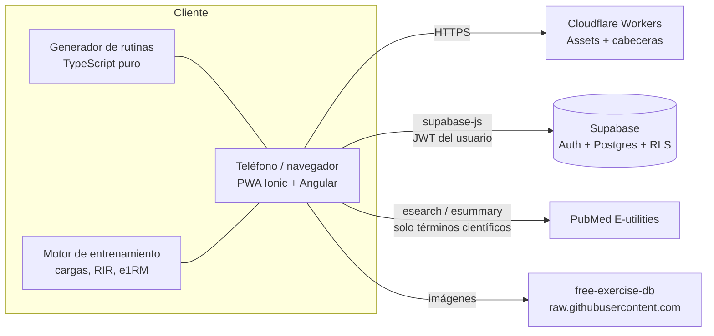

<div align="center">

# Dinovance Gym

**Rutinas de entrenamiento personalizadas y basadas en evidencia científica, en una PWA móvil.**

[](https://github.com/Tufavo1/Dinovance-Gym/actions/workflows/ci.yml)
[](https://github.com/Tufavo1/Dinovance-Gym/actions/workflows/codeql.yml)


</div>

---

## Tabla de contenidos

1. [Descripción](#descripción)
2. [Funcionalidades](#funcionalidades)
3. [Arquitectura](#arquitectura)
4. [Stack tecnológico](#stack-tecnológico)
5. [Estructura del repositorio](#estructura-del-repositorio)
6. [Motor de rutinas basado en evidencia](#motor-de-rutinas-basado-en-evidencia)
7. [Sistema de entrenamiento para dos personas](#sistema-de-entrenamiento-para-dos-personas)
8. [Puesta en marcha](#puesta-en-marcha)
9. [Base de datos y migraciones](#base-de-datos-y-migraciones)
10. [Calidad y pruebas](#calidad-y-pruebas)
11. [CI/CD y despliegue](#cicd-y-despliegue)
12. [Seguridad](#seguridad)
13. [Accesibilidad y UX](#accesibilidad-y-ux)
14. [PWA y modo sin conexión](#pwa-y-modo-sin-conexión)
15. [Limitaciones conocidas](#limitaciones-conocidas)
16. [Aviso importante](#aviso-importante)

---

## Descripción

Dinovance Gym resuelve un problema concreto: las rutinas genéricas ignoran quién eres. La aplicación
recoge un cuestionario (experiencia, lesiones, equipamiento, tiempo, marcas de fuerza, frecuencia
deseada) y genera una rutina **determinista, auditable y respaldada por estudios publicados**. Después
guía cada sesión en el gimnasio, registra el progreso y ajusta las cargas.

Principios de diseño:

- **Evidencia primero.** Cada regla de programación (volumen, frecuencia, RIR, descargas) apunta a su
  referencia; la app las muestra y las verifica contra PubMed en vivo.
- **Seguridad de la persona.** Lesiones, embarazo, condición médica y edad excluyen ejercicios; nunca se
  recomienda algo fuera del equipo disponible.
- **Código determinista y probado.** El generador es TypeScript puro, sin IA ni aleatoriedad opaca, con
  pruebas unitarias.
- **Datos privados por diseño.** Row Level Security en todas las tablas y CSP estricta.

## Funcionalidades

| Área | Detalle |
| --- | --- |
| **Cuestionario** | Experiencia, objetivos, modalidad, lesiones, enfoque (equilibrado, alta intensidad, alto volumen), nutrición, estrés, marcas de fuerza (RM/PR) y frecuencia semanal deseada por grupo muscular. |
| **Equipo disponible** | Antes de crear o generar una rutina se pregunta qué máquinas y accesorios hay a mano. Los implementos extra salen del **dataset de ejercicios cargado** y se muestra cuántos ejercicios desbloquea cada uno. |
| **Rutina generada** | Distribución semanal, ejercicios, series, repeticiones y descansos según perfil, con tarjeta «Por qué esta rutina» (volumen por músculo vs. rango recomendado y estudios). |
| **Rutina manual** | Maniquí **3D** seleccionable (three.js): se gira con el dedo y se toca un músculo para ver sus ejercicios. Avisos argumentados por día (carga, orden, equilibrio, lesiones). |
| **Edición** | Agregar, quitar, reordenar y modificar ejercicios de cualquier día de una rutina existente. |
| **Entrenamiento guiado** | Ejercicio por ejercicio, con peso recomendado, RIR por serie, cronómetros, pausa, calificación y cambio de ejercicio por alternativas seguras. |
| **Progreso** | Tonelaje, series efectivas, constancia y peso corporal. |
| **Ciencia** | Lista de referencias (PubMed, Journal of Strength and Conditioning Research y libros), búsqueda en vivo en PubMed y verificación automática de las citas. |
| **Mensajes** | Bandeja con avisos útiles generados a partir del perfil y la actividad. |
| **Fichas de ejercicio** | Para qué sirve, ventajas y cuidados en tres líneas, más claves de técnica y ficha técnica (patrón, músculos por porción, errores, precauciones, variantes). |
| **Cargas flexibles** | Cualquier peso escrito a mano (con decimales), kg, lb, niveles de máquina, placas u otra unidad; carga por serie, por lado, lastre o asistencia. Configuración propia por máquina. |
| **Progresión** | Doble progresión por reglas con los registros reales: sube solo si todas las series llegan al tope del rango con el RIR objetivo. Detecta estancamiento y caídas. Se acepta o rechaza. |
| **Informe semanal** | Cumplimiento, volumen directo e indirecto por músculo, evolución por ejercicio, desequilibrios, fatiga y molestias declaradas, recomendaciones justificadas. |
| **Evolución** | Progresión por ejercicio con filtro de fechas, comparación entre semanas, mediciones corporales y metas. |
| **Pareja** | Vínculo opcional entre dos cuentas: compartir una rutina (sin cargas) y comparación agregada solo con consentimiento. |
| **Mis datos** | Exportar (JSON / CSV), importar sin duplicar e historial de modificaciones. |

## Arquitectura



- **Sin servidor de aplicación propio.** Las reglas de entrenamiento (generador, progresión, informe) son
  módulos TypeScript puros, separados de la interfaz y probados; la integridad, la validación y la
  autorización las imponen Postgres (RLS, `CHECK`, claves foráneas) y sus funciones RPC.
- **Estado reactivo** con *signals* de Angular; rutas perezosas por pantalla; Three.js se carga solo en
  la pantalla de crear rutina.
- **Offline-first** para la rutina activa (almacenamiento local del dispositivo) y cola de entrenamientos pendientes.

## Stack tecnológico

| Capa | Tecnología |
| --- | --- |
| Interfaz | Ionic 9, Angular 22 (componentes standalone, signals), SCSS con variables CSS y modo oscuro |
| 3D | three.js (maniquí procedural con *raycasting*) |
| Datos | Supabase: Auth, Postgres 17, RLS, RPC en PL/pgSQL |
| Hosting | Cloudflare Workers (Static Assets) con SPA fallback y cabeceras de seguridad |
| Pruebas | Vitest (unitarias), Playwright (e2e) |
| Calidad | ESLint (`angular-eslint`), Prettier, TypeScript estricto |
| CI/CD | GitHub Actions, CodeQL, Dependabot |
| Móvil | Capacitor (haptics, teclado, status bar) |

## Estructura del repositorio

```text
.
├── .github/workflows/        # ci.yml, deploy.yml, codeql.yml (+ dependabot.yml)
├── e2e/                      # Pruebas Playwright
├── scripts/
│   ├── import-exercises.mjs  # Carga free-exercise-db en Supabase
│   └── check-secrets.mjs     # Falla si hay claves privadas versionadas
├── supabase/
│   ├── schema.sql            # Esquema completo (base nueva)
│   └── migrations/           # 001 … 012, idempotentes
├── src/
│   ├── _headers              # CSP, HSTS y cache de Cloudflare
│   ├── robots.txt
│   └── app/
│       ├── core/
│       │   ├── routine/      # Generador: perfil del atleta, reglas, prescripción
│       │   ├── evidence/     # Referencias, programación, explicaciones, PubMed
│       │   ├── training/     # Cargas, e1RM, marcas de fuerza, fichas de ejercicio
│       │   ├── manual/       # Reglas de la rutina manual
│       │   └── *.service.ts  # Auth, perfil, rutinas, estadísticas, mensajes
│       ├── pages/            # login, registro, onboarding, rutina, manual, workout, progreso…
│       └── shared/           # Maniquí 3D, selector de ejercicios, modal de equipo, tarjetas
├── angular.json · wrangler.jsonc · ngsw-config.json
└── playwright.config.ts · vitest.config.mts
```

## Motor de rutinas basado en evidencia

El generador (`src/app/core/routine/`) decide en este orden y **siempre dentro de los límites del
perfil**:

1. **Perfil del atleta** (`athlete-profile.ts`): nivel, tiempo sin entrenar, edad, embarazo/posparto,
   condición médica, sueño, estrés, fase nutricional y enfoque. El historial manda: un intermedio con más
   de 6 meses sin entrenar parte como principiante.
2. **Equipo y lugar** (`equipment.ts`): solo ejercicios cuyo equipo requerido está marcado. Los
   implementos se reconocen por el nombre del ejercicio del dataset.
3. **Salud:** lesiones activas, cirugías y embarazo excluyen ejercicios por músculo, categoría y nombre.
4. **Objetivo, modalidad y frecuencia:** elige la distribución semanal (cuerpo completo, superior/inferior,
   empuje/tirón/piernas) según los días y la frecuencia pedida por grupo muscular.
5. **Volumen** (`programming.ts`): ajusta las series semanales de cada músculo al rango de su nivel y
   enfoque, dentro del tiempo disponible.
6. **Cargas** (`training/load-advisor.ts`): con historial usa e1RM (repeticiones + RIR); la primera vez
   parte de las **marcas de fuerza** de la persona (o de una estimación por peso corporal) con margen de
   seguridad.

### Principios y referencias

| Decisión | Respaldo |
| --- | --- |
| Volumen semanal por músculo | Schoenfeld et al. 2017; Israetel (RP) |
| Frecuencia ≥ 2×/semana | Schoenfeld et al. 2016 y 2019 |
| Rangos de repeticiones y descansos | Schoenfeld 2016, 2017 y 2021 |
| Repeticiones en reserva (RIR) | Refalo 2023; Helms 2016; Zourdos 2016 |
| Descarga y mesociclos | Bell 2022; Israetel |
| Proteína | Morton 2018; Helms 2014 |
| Cardio concurrente | Wilson 2012 |
| Dosis mínima (opcional) | Krieger 2010; Androulakis-Korakakis 2020 |
| Posición alargada del músculo | Maeo; Wolf 2023 |
| RM estimado y estándares de fuerza | LeSuer 1997; Brzycki 1993; Rippetoe y Kilgore |

La lista completa y sus conclusiones prácticas están en `src/app/core/evidence/references.ts` y en la
pantalla **Ciencia** de la app, que verifica cada cita contra PubMed (título + año).

## Sistema de entrenamiento para dos personas

Mejora integral para que dos personas (por ejemplo, una pareja) entrenen con perfiles **independientes**.
Principio rector: *preferimos decir "no hay datos suficientes" antes que inventar una recomendación*.

### Datos de referencia analizados

Se revisaron [Gym-Membership-Attendance-Tracker-System](https://github.com/CSPruthveesh/Gym-Membership-Attendance-Tracker-System)
y [Fithub](https://github.com/Ajha2005/Fithub). Ambos son sistemas de **gestión de gimnasio** (socios, planes,
pagos, asistencia, mantenimiento de equipos); no traen catálogo de ejercicios, series ni progresión, así que no
había datos útiles que importar. Se aprovechó su diseño: restricciones `CHECK` con nombre, auditoría por
disparadores (`Member_Status_Logs`), metas con estado (`member_fitness_goals`) y mediciones corporales
(`member_body_metrics`). Se mejoró lo que limitaba: aquí todo es por usuario autenticado con RLS, las metas
tienen relación con el ejercicio o la medida, y la auditoría guarda el valor anterior **y** el nuevo.

### Arquitectura de las piezas nuevas

| Capa | Archivo | Qué hace |
| --- | --- | --- |
| Anatomía | `core/anatomy/muscles.ts` | 62 músculos y porciones (grupo → músculo → porción) y 27 patrones de movimiento. Fuente única de las tablas `muscles` y `movement_patterns`. |
| Catálogo | `core/catalog/curated.ts` | 102 fichas revisadas a mano (8 ejercicios propios `DV_`). Lo no revisado queda `pendiente_revision`. |
| Generador | `core/routine/generator.ts` | Reglas sin azar; cobertura de aductores, abductores y pantorrillas; historial; justificación por ejercicio; sustitución por patrón. |
| Progresión | `core/progression/` | Unidades de carga, doble progresión y propuesta de carga de cada sesión. |
| Análisis | `core/analysis/` | Informe semanal y series históricas por ejercicio (funciones puras). |
| Datos | `core/data/export.ts` | CSV y JSON de ida y vuelta. |
| Servicios | `*.service.ts` | Acceso a Supabase; nunca contienen reglas de entrenamiento. |
| Pantallas | `pages/report`, `evolution`, `partner`, `data` | Solo presentación. |

Las reglas (generador, progresión, informe) son TypeScript puro sin dependencias de Angular, probadas con
datos sintéticos. La integridad la impone la base: claves foráneas, `CHECK`, RLS y funciones RPC que validan.

### Catálogo y anatomía

- `exercise_muscles` relaciona cada ejercicio con sus músculos (`principal` / `secundario`). En las fichas
  verificadas usa porciones (pectoral clavicular, vasto medial…); en el resto, el músculo grueso del dataset,
  sin inventar porciones.
- Cada ejercicio tiene `movement_pattern`, `muscle_function`, `common_errors`, `precautions`,
  `safety_notes`, `variants`, rango de repeticiones orientativo y `review_status`. Los patrones de lo no
  revisado se deducen del nombre y se muestran como "pendiente de revisión".
- Los músculos originales del dataset se conservan en `dataset_muscles` (la reversa los restaura).
- Para editar el catálogo: cambia `muscles.ts` o `curated.ts` y ejecuta `node scripts/build-catalog-sql.mjs`,
  que valida los códigos y regenera `014_catalog_seed.sql`.

### Aductores

Trabajo directo: máquina de aductores, aducción en polea, con banda, tumbado de lado y plancha Copenhague.
Participación secundaria registrada en sentadillas (incluidas plié y abierta), prensa, peso muerto sumo,
zancada lateral, hip thrust y peso muerto rumano, entre otros.

El generador asegura **al menos un ejercicio directo de aductores por semana** con cualquier nivel, días y
duración (probado en 60 combinaciones). Si no cabe, puede alargar la sesión hasta 8 minutos con 2 series; si
no hay ningún ejercicio posible (equipo o lesión), lo dice en las notas en lugar de omitirlo en silencio.
Abductores y pantorrillas entran si caben, y si no, también se avisa.

### Generador de rutinas

- Determinista: los mismos datos dan la misma rutina (se eliminó el azar).
- Antes de generar exige experiencia, objetivo, días, duración, última vez que entrenó, edad, lugar y equipo
  confirmado. Si falta algo, lo pide (`MissingRoutineDataError`).
- Usa el historial **de la propia persona** (últimos 60 días): mantiene los ejercicios con progresión en
  curso, rota los estancados por una variante equivalente y avisa si el primer día repite un grupo entrenado
  hace menos de 48 h.
- Cada lugar de la plantilla lo ocupa un ejercicio cuyo **motor primario** es ese músculo.
- Cada ejercicio guarda RIR objetivo, tempo (solo donde aporta) y una justificación con músculos, patrón,
  equipo y motivo; cada día guarda su objetivo.
- **Sustitución**: solo se ofrece un ejercicio con el mismo músculo principal y el mismo patrón de movimiento
  (o, si falta el patrón, el mismo tipo compuesto/aislado), compatible con equipo, nivel, lesiones y
  preferencias. Si no existe, no se ofrece "algo parecido". Una prensa nunca reemplaza a la máquina de aductores.

### Cargas flexibles

- El campo de carga es libre: 5, 7, 12,5, 17,5, 22,5… sin lista de valores. Los botones + y − son un atajo.
- Unidades: `kg`, `lb`, `nivel`, `placas`, `otro` (con nombre propio). Tipos: total, por lado, peso
  corporal, lastre, asistido. Se guarda `load_value` + `load_unit` tal cual; `weight_kg` solo existe para kg
  y lb. **Un nivel nunca se convierte a kilos** (la base lo impide con un `CHECK`).
- `exercise_load_settings` (por persona y ejercicio): unidad, salto mínimo, rango de la máquina, carga
  inicial y nombre. Todo opcional; lo que no se define no se inventa.
- La app **nunca** modifica una carga registrada: solo propone.

### Progresión semanal

Doble progresión (`core/progression/progression.ts`) sobre las sesiones reales de un ejercicio:

| Situación | Resultado |
| --- | --- |
| Todas las series en el tope del rango y RIR ≥ objetivo | Sube al **siguiente valor que existe** en el equipo (nunca "nivel 5,5") |
| Salto > 10 % o de tamaño desconocido (niveles) | Pide confirmarlo en una segunda sesión |
| Tope sin RIR registrado o al límite | Mantiene |
| Dentro del rango | Mantiene y suma repeticiones |
| Bajo el mínimo | Mantiene; si se repite, baja un salto |
| 3 sesiones igual con la misma carga | Estancamiento |
| Tope de la máquina | Progresa con repeticiones o tempo |
| Sin registros | `sin_datos`: usa la carga inicial configurada o deja el campo vacío |

Escenario de referencia (probado): press de banca 30 kg, 3 × 8-12, RIR 2 → semanas 10/9/8, 11/10/9, 12/12/11
mantienen; 12/12/12 sube a 32,5 kg. Repetir 10/9/8 cuatro semanas **no** sube y marca estancamiento.

No se mezclan sesiones en unidades distintas. La progresión se ordena por la fecha real del entrenamiento
(vista `set_history`), no por la fecha de importación. Las estimaciones por peso corporal ya no rellenan el
campo: se muestran como "referencia orientativa, no es un dato tuyo".

### Informe semanal automático

Al abrir Inicio se generan en segundo plano los informes de las semanas **terminadas** que falten
(`weekly_reports`, uno por lunes) y se guardan las recomendaciones de carga (`load_recommendations`) para
aceptarlas o rechazarlas. Rechazar se respeta en la siguiente sesión. El informe declara lo que no pudo
analizar (sin RIR, sin semanas previas, sin rutina activa, sin recuperación declarada) y no asume que hubo
recuperación. Fatiga alta o molestias declaradas frenan las subidas.

### Dos perfiles independientes

- Cada persona tiene su cuenta: perfil, cuestionario, rutinas, configuración de máquinas, historial,
  informes, metas y mediciones. RLS impide leer o escribir datos ajenos (probado).
- `partner_links`: vínculo opcional por correo, que la otra persona debe aceptar.
- `share_routine_with_partner`: la otra persona recibe una **copia inactiva** sin cargas; cada quien la edita
  y progresa con su historial.
- `partner_weekly_summary`: solo conteos (sesiones, minutos, series por grupo) y solo si la otra persona
  activó compartir. Nunca pesos, repeticiones ni datos de salud, y nada de esto alimenta recomendaciones.

### Datos, auditoría y respaldos

- `export_my_data()` (JSON completo) y CSV con una fila por serie; `import_my_workouts()` importa con
  `client_id` (no duplica) y rechaza completos los entrenamientos inválidos, informando el motivo.
- `audit_log`: cada `UPDATE`/`DELETE` de series, entrenamientos, mediciones, configuración, metas y perfil
  guarda el valor anterior y el nuevo. Solo lectura para su dueño.
- `log_workout` es idempotente por `client_id` (los reintentos sin conexión no duplican) y rechaza unidades
  desconocidas, ejercicios inexistentes y fechas futuras.
- `scripts/backup.sh`: respaldo con `pg_dump` (carpeta `backups/`, ignorada por git, permisos 600).

## Puesta en marcha

**Requisitos:** Node 22+, npm, Docker (solo para Supabase local).

```bash
git clone https://github.com/Tufavo1/Dinovance-Gym.git
cd Dinovance-Gym
npm ci
npm run db:start      # Supabase local en Docker (puertos 544xx)
npm start             # http://localhost:4200 contra la base local
```

- Studio (tablas): <http://127.0.0.1:54423> · Correos de prueba: <http://127.0.0.1:54424>
- `npm run start:cloud` usa el proyecto Supabase de la nube (`src/environments/environment.ts`).
- `npm run db:stop` detiene la base sin borrar datos.

### Variables y configuración

| Archivo | Uso |
| --- | --- |
| `src/environments/environment*.ts` | URL del proyecto y clave **anon** (pública por diseño; la protección real es RLS). |
| `.env.local` (no versionado) | Solo para `scripts/import-exercises.mjs`: `SUPABASE_URL` y `SUPABASE_SERVICE_ROLE_KEY`. |

> La clave `service_role` **nunca** va en la app ni en git. El pipeline lo verifica
> (`scripts/check-secrets.mjs`).

### Base de datos desde cero

```bash
docker exec -i supabase_db_dinovance-gym psql -U postgres < supabase/schema.sql
SUPABASE_URL=http://127.0.0.1:54421 SUPABASE_SERVICE_ROLE_KEY=<service_role local> \
  node scripts/import-exercises.mjs
```

Después aplica las migraciones nuevas (el esquema base llega hasta la 012):

```bash
for f in supabase/migrations/01[3-8]_*.sql; do
  docker exec -i supabase_db_dinovance-gym psql -U postgres -v ON_ERROR_STOP=1 --single-transaction < "$f"
done
```

La clave local la muestra `npx supabase status`. El script carga
[free-exercise-db](https://github.com/yuhonas/free-exercise-db) (Unlicense) en `public.exercises`.

## Base de datos y migraciones

Las migraciones son **idempotentes** y el pipeline las aplica solas al desplegar (`scripts/migrate.sh`):
llevan registro en `public.app_migrations` (RLS activado, sin políticas), cada una corre en una transacción
y, la primera vez, se toman como ya aplicadas las anteriores a `MIGRATIONS_BASELINE` (010). También se pueden
ejecutar a mano en el SQL Editor, en orden.

```bash
SUPABASE_DB_URL="postgresql://..." scripts/migrate.sh --dry-run   # muestra qué se aplicaría
SUPABASE_DB_URL="postgresql://..." scripts/migrate.sh             # aplica las pendientes
```

| Migración | Contenido |
| --- | --- |
| `001`–`003` | Modalidades de entrenamiento, equipamiento por lugar, objetivos |
| `004` | Historial de entrenamientos y series |
| `005` | Rutinas por RPC (`save_routine`, `activate_routine`) y seguridad |
| `006`–`007` | Métricas (tonelaje, series efectivas) y tiempos por serie |
| `008` | Calificaciones, cambio de ejercicio y pausa |
| `009` | Motivos de fin anticipado de sesión |
| `010` | Límites de ejercicios por día en el servidor |
| `011` | Enfoque, nutrición y estrés; peso corporal (`body_metrics`); `replace_day_exercises` |
| `012` | Marcas de fuerza (`strength_marks`) y frecuencia por músculo (`muscle_frequency`) |
| `013` | Anatomía y catálogo avanzado: `muscles`, `movement_patterns`, `exercise_muscles`, ficha de ejercicio, vista `exercise_catalog` |
| `014` | Datos del catálogo (generada por `scripts/build-catalog-sql.mjs`) |
| `015` | Cargas flexibles (`exercise_load_settings`, unidades en `set_logs`), estado declarado, idempotencia, vista `set_history` |
| `016` | `load_recommendations`, `weekly_reports`, `fitness_goals`, `body_measurements`; RIR, tempo, justificación y objetivo en rutinas |
| `017` | Vínculo de pareja y sus funciones |
| `018` | `audit_log`, `export_my_data`, `import_my_workouts` |

Las migraciones 013 a 018 tienen reversa en `supabase/migrations/down/` y se pueden revertir con
`scripts/migrate-down.sh NNN` (haz antes un respaldo con `scripts/backup.sh`). La reversa conserva el
historial de entrenamientos; solo se pierde lo que agregan esas migraciones.

Modelo de seguridad de datos: cada tabla de usuario tiene una política `propio` (`user_id = auth.uid()`),
los catálogos son de solo lectura y las funciones RPC son `SECURITY INVOKER` con `search_path` fijo.

## Calidad y pruebas

| Comando | Qué hace |
| --- | --- |
| `npm start` | Servidor de desarrollo contra Supabase local |
| `npm run build` | Build de producción en `www/` |
| `npm run lint` | ESLint + tipos e2e + Prettier |
| `npm run test:unit` | Pruebas unitarias (Vitest): generador, cargas, marcas, equipo |
| `npx playwright test` | Pruebas e2e (Chrome instalado) |
| `node scripts/check-secrets.mjs` | Busca claves privadas en archivos versionados |
| `scripts/test-db.sh` | Pruebas de integración de la base sobre una copia desechable: migraciones dos veces, RLS entre dos personas, unidades, idempotencia, pareja, auditoría, importación y reversas |

Pruebas unitarias actuales: 109 (generador, aductores, progresión con escenarios reales, informe semanal,
cargas, CSV/JSON). La auditoría anterior cubrió: 64 pruebas unitarias, e2e, 28 flujos funcionales en navegador,
auditoría **axe-core** en 10 pantallas (claro y oscuro), revisión de cabeceras y política CSP con
`wrangler dev`, y `npm audit` de producción sin vulnerabilidades.

## CI/CD y despliegue

| Workflow | Disparador | Qué hace |
| --- | --- | --- |
| `ci.yml` | PR y push a `main` | Lint, pruebas unitarias, build, e2e (Playwright), `npm audit` y búsqueda de secretos |
| `deploy.yml` | Push a `main` / manual | Repite lint, pruebas y build; aplica las migraciones pendientes de Supabase; despliega con Wrangler y verifica el sitio (HTTP 200, cabeceras de seguridad, `ngsw.json` sin caché) |
| `codeql.yml` | PR, push y semanal | Análisis estático de seguridad (`security-extended`) |
| `dependabot.yml` | Semanal | Actualizaciones de npm y de GitHub Actions |

Los workflows usan filtros de rutas: un cambio solo de documentación (README, `.md`, `.gitignore`,
`robots.txt`…) **no dispara nada**. El despliegue solo corre si cambió `src/`, `supabase/`, `scripts/`,
dependencias o configuración de build; CodeQL solo si cambió código (además de su corrida semanal).
Cualquier workflow se puede forzar a mano desde Actions → *Run workflow*.

**Configuración requerida en GitHub** (Settings → Secrets and variables → Actions):

- Secretos: `CLOUDFLARE_API_TOKEN`, `CLOUDFLARE_ACCOUNT_ID` y `SUPABASE_DB_URL` (cadena del **pooler** de
  Supabase en modo *session*, `postgresql://postgres.<ref>:<clave>@aws-0-<región>.pooler.supabase.com:5432/postgres`;
  la conexión directa es solo IPv6 y los runners de GitHub no la alcanzan).
- Variable opcional: `SITE_URL` (por defecto `https://avanza.dinovance.cl`).
- Environment `production` (permite exigir aprobación manual).
- Recomendado: proteger `main` y exigir que pase `Lint, pruebas y build`.

**Despliegue manual:**

```bash
npm ci && npm run lint && npx ng test --no-watch
npx ng build
npx wrangler deploy
```

Las migraciones se aplican en el paso previo al despliegue. Para volver atrás el código:
`npx wrangler rollback` (las migraciones no se revierten: solo agregan estructura).

## Seguridad

- **RLS** en todas las tablas de usuario; catálogos de solo lectura. Un índice único garantiza una sola
  rutina activa por usuario.
- **RPC `SECURITY INVOKER`** (`save_routine`, `replace_day_exercises`…): validan pertenencia, límites y
  rangos; operaciones atómicas.
- **Validación en capas:** restricciones `CHECK` en la base de datos y saneamiento en el cliente (marcas,
  frecuencias, rangos).
- **Cabeceras** (`src/_headers`): CSP estricta (`script-src 'self'`, `object-src 'none'`,
  `frame-ancestors 'none'`), HSTS, `X-Content-Type-Options`, `X-Frame-Options`, `Permissions-Policy`,
  `Cross-Origin-Opener-Policy`. Las consultas a PubMed envían solo términos científicos, nunca datos de la
  persona.
- **Sesión y privacidad:** al cerrar sesión se borra lo guardado en el dispositivo (borradores con datos
  de salud, rutina). Contraseñas de 8+ caracteres con letras y números.
- **Cadena de suministro:** Dependabot, `npm audit` en CI, CodeQL y verificación de secretos.
- **Hosting:** `workers_dev` y *preview URLs* desactivadas; solo responde el dominio propio.

Para reportar una vulnerabilidad, abre un aviso privado de seguridad en el repositorio (no un issue
público).

## Accesibilidad y UX

- Cumplimiento verificado con axe-core (WCAG 2.1 A/AA): contraste, nombres accesibles, zoom habilitado,
  íconos decorativos ocultos a lectores de pantalla.
- Objetivos táctiles de al menos 44 px; sin desbordamiento horizontal entre 320 y 1280 px.
- Modo claro y oscuro con tokens de color; textos breves y orientados a la acción.
- Decisiones de interfaz basadas en heurísticas (Fitts, Hick, Jakob, Tesler): acción principal siempre
  abajo, progresión por pasos y borradores automáticos.

## PWA y modo sin conexión

- Service worker de Angular con aviso de «versión nueva».
- La rutina activa se ve sin conexión; los entrenamientos terminados sin red quedan en cola y se
  sincronizan después.
- Las imágenes de ejercicios se guardan en caché.
- `manifest.webmanifest` con iconos *maskable* y modo *standalone*.

## Limitaciones conocidas

- El maniquí 3D es **estilizado** (procedural), no un escaneo anatómico. Sustituirlo por un modelo GLB
  solo requiere cambiar `shared/body-map.component.ts`.
- Con el maniquí de frente, las pantorrillas se eligen desde la vista de espalda o la lista de zonas.
- Las fichas «sirve para / a favor / ojo» son resúmenes por patrón de movimiento, no por ejercicio.
- Los estándares de fuerza por peso corporal son referencias prácticas (Rippetoe), no un diagnóstico.
- El migrador es propio y mínimo (sin migraciones de reversa): las migraciones solo agregan estructura.
- La velocidad de barra (VBT) no se mide: requiere un sensor.
- 102 ejercicios tienen ficha verificada; el resto (≈780) conserva los músculos del dataset y su patrón está
  deducido del nombre o pendiente. La interfaz lo indica en cada ficha.
- Los ejercicios propios (`DV_`) no tienen imágenes.
- El informe semanal se genera al abrir la app (no hay tarea programada en el servidor); el cálculo corre en
  el dispositivo con funciones puras y probadas, y la base valida todo lo que se guarda.
- Los rangos de volumen por músculo existen para los grupos grandes; aductores, abductores y otros se
  muestran "sin referencia" en lugar de inventar un rango.

## Aviso importante

Dinovance Gym es una herramienta de apoyo al entrenamiento. **No reemplaza el consejo de un médico, un
kinesiólogo o un entrenador.** Quien tenga una condición médica, lesión, embarazo o posparto debe
consultar a un profesional antes de seguir cualquier rutina.

---

<div align="center">

Proyecto privado de Dinovance · Datos de ejercicios: [free-exercise-db](https://github.com/yuhonas/free-exercise-db) (Unlicense)

</div>
