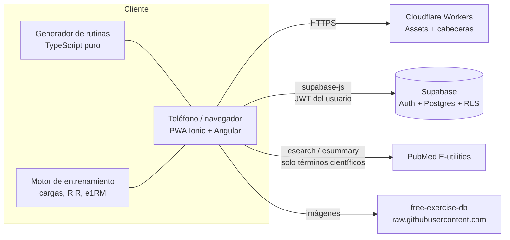

<div align="center">

# Dinovance Gym

**Rutinas de entrenamiento personalizadas y basadas en evidencia científica, en una PWA móvil.**

[](https://github.com/Tufavo1/Dinovance-Gym/actions/workflows/ci.yml)
[](https://github.com/Tufavo1/Dinovance-Gym/actions/workflows/codeql.yml)


</div>

---

## Tabla de contenidos

1. [Descripción](#descripción)
2. [Funcionalidades](#funcionalidades)
3. [Arquitectura](#arquitectura)
4. [Stack tecnológico](#stack-tecnológico)
5. [Estructura del repositorio](#estructura-del-repositorio)
6. [Motor de rutinas basado en evidencia](#motor-de-rutinas-basado-en-evidencia)
7. [Puesta en marcha](#puesta-en-marcha)
8. [Base de datos y migraciones](#base-de-datos-y-migraciones)
9. [Calidad y pruebas](#calidad-y-pruebas)
10. [CI/CD y despliegue](#cicd-y-despliegue)
11. [Seguridad](#seguridad)
12. [Accesibilidad y UX](#accesibilidad-y-ux)
13. [PWA y modo sin conexión](#pwa-y-modo-sin-conexión)
14. [Limitaciones conocidas](#limitaciones-conocidas)
15. [Aviso importante](#aviso-importante)

---

## Descripción

Dinovance Gym resuelve un problema concreto: las rutinas genéricas ignoran quién eres. La aplicación
recoge un cuestionario (experiencia, lesiones, equipamiento, tiempo, marcas de fuerza, frecuencia
deseada) y genera una rutina **determinista, auditable y respaldada por estudios publicados**. Después
guía cada sesión en el gimnasio, registra el progreso y ajusta las cargas.

Principios de diseño:

- **Evidencia primero.** Cada regla de programación (volumen, frecuencia, RIR, descargas) apunta a su
  referencia; la app las muestra y las verifica contra PubMed en vivo.
- **Seguridad de la persona.** Lesiones, embarazo, condición médica y edad excluyen ejercicios; nunca se
  recomienda algo fuera del equipo disponible.
- **Código determinista y probado.** El generador es TypeScript puro, sin IA ni aleatoriedad opaca, con
  pruebas unitarias.
- **Datos privados por diseño.** Row Level Security en todas las tablas y CSP estricta.

## Funcionalidades

| Área | Detalle |
| --- | --- |
| **Cuestionario** | Experiencia, objetivos, modalidad, lesiones, enfoque (equilibrado, alta intensidad, alto volumen), nutrición, estrés, marcas de fuerza (RM/PR) y frecuencia semanal deseada por grupo muscular. |
| **Equipo disponible** | Antes de crear o generar una rutina se pregunta qué máquinas y accesorios hay a mano. Los implementos extra salen del **dataset de ejercicios cargado** y se muestra cuántos ejercicios desbloquea cada uno. |
| **Rutina generada** | Distribución semanal, ejercicios, series, repeticiones y descansos según perfil, con tarjeta «Por qué esta rutina» (volumen por músculo vs. rango recomendado y estudios). |
| **Rutina manual** | Maniquí **3D** seleccionable (three.js): se gira con el dedo y se toca un músculo para ver sus ejercicios. Avisos argumentados por día (carga, orden, equilibrio, lesiones). |
| **Edición** | Agregar, quitar, reordenar y modificar ejercicios de cualquier día de una rutina existente. |
| **Entrenamiento guiado** | Ejercicio por ejercicio, con peso recomendado, RIR por serie, cronómetros, pausa, calificación y cambio de ejercicio por alternativas seguras. |
| **Progreso** | Tonelaje, series efectivas, constancia y peso corporal. |
| **Ciencia** | Lista de referencias (PubMed, Journal of Strength and Conditioning Research y libros), búsqueda en vivo en PubMed y verificación automática de las citas. |
| **Mensajes** | Bandeja con avisos útiles generados a partir del perfil y la actividad. |
| **Fichas de ejercicio** | Para qué sirve, ventajas y cuidados en tres líneas, más claves de técnica. |

## Arquitectura



- **Sin backend propio.** La lógica de negocio crítica corre en el cliente (generador y asesor de cargas)
  y la autorización la imponen las políticas RLS y las funciones `SECURITY INVOKER` de Postgres.
- **Estado reactivo** con *signals* de Angular; rutas perezosas por pantalla; Three.js se carga solo en
  la pantalla de crear rutina.
- **Offline-first** para la rutina activa (almacenamiento local del dispositivo) y cola de entrenamientos pendientes.

## Stack tecnológico

| Capa | Tecnología |
| --- | --- |
| Interfaz | Ionic 9, Angular 22 (componentes standalone, signals), SCSS con variables CSS y modo oscuro |
| 3D | three.js (maniquí procedural con *raycasting*) |
| Datos | Supabase: Auth, Postgres 17, RLS, RPC en PL/pgSQL |
| Hosting | Cloudflare Workers (Static Assets) con SPA fallback y cabeceras de seguridad |
| Pruebas | Vitest (unitarias), Playwright (e2e) |
| Calidad | ESLint (`angular-eslint`), Prettier, TypeScript estricto |
| CI/CD | GitHub Actions, CodeQL, Dependabot |
| Móvil | Capacitor (haptics, teclado, status bar) |

## Estructura del repositorio

```text
.
├── .github/workflows/        # ci.yml, deploy.yml, codeql.yml (+ dependabot.yml)
├── e2e/                      # Pruebas Playwright
├── scripts/
│   ├── import-exercises.mjs  # Carga free-exercise-db en Supabase
│   └── check-secrets.mjs     # Falla si hay claves privadas versionadas
├── supabase/
│   ├── schema.sql            # Esquema completo (base nueva)
│   └── migrations/           # 001 … 012, idempotentes
├── src/
│   ├── _headers              # CSP, HSTS y cache de Cloudflare
│   ├── robots.txt
│   └── app/
│       ├── core/
│       │   ├── routine/      # Generador: perfil del atleta, reglas, prescripción
│       │   ├── evidence/     # Referencias, programación, explicaciones, PubMed
│       │   ├── training/     # Cargas, e1RM, marcas de fuerza, fichas de ejercicio
│       │   ├── manual/       # Reglas de la rutina manual
│       │   └── *.service.ts  # Auth, perfil, rutinas, estadísticas, mensajes
│       ├── pages/            # login, registro, onboarding, rutina, manual, workout, progreso…
│       └── shared/           # Maniquí 3D, selector de ejercicios, modal de equipo, tarjetas
├── angular.json · wrangler.jsonc · ngsw-config.json
└── playwright.config.ts · vitest.config.mts
```

## Motor de rutinas basado en evidencia

El generador (`src/app/core/routine/`) decide en este orden y **siempre dentro de los límites del
perfil**:

1. **Perfil del atleta** (`athlete-profile.ts`): nivel, tiempo sin entrenar, edad, embarazo/posparto,
   condición médica, sueño, estrés, fase nutricional y enfoque. El historial manda: un intermedio con más
   de 6 meses sin entrenar parte como principiante.
2. **Equipo y lugar** (`equipment.ts`): solo ejercicios cuyo equipo requerido está marcado. Los
   implementos se reconocen por el nombre del ejercicio del dataset.
3. **Salud:** lesiones activas, cirugías y embarazo excluyen ejercicios por músculo, categoría y nombre.
4. **Objetivo, modalidad y frecuencia:** elige la distribución semanal (cuerpo completo, superior/inferior,
   empuje/tirón/piernas) según los días y la frecuencia pedida por grupo muscular.
5. **Volumen** (`programming.ts`): ajusta las series semanales de cada músculo al rango de su nivel y
   enfoque, dentro del tiempo disponible.
6. **Cargas** (`training/load-advisor.ts`): con historial usa e1RM (repeticiones + RIR); la primera vez
   parte de las **marcas de fuerza** de la persona (o de una estimación por peso corporal) con margen de
   seguridad.

### Principios y referencias

| Decisión | Respaldo |
| --- | --- |
| Volumen semanal por músculo | Schoenfeld et al. 2017; Israetel (RP) |
| Frecuencia ≥ 2×/semana | Schoenfeld et al. 2016 y 2019 |
| Rangos de repeticiones y descansos | Schoenfeld 2016, 2017 y 2021 |
| Repeticiones en reserva (RIR) | Refalo 2023; Helms 2016; Zourdos 2016 |
| Descarga y mesociclos | Bell 2022; Israetel |
| Proteína | Morton 2018; Helms 2014 |
| Cardio concurrente | Wilson 2012 |
| Dosis mínima (opcional) | Krieger 2010; Androulakis-Korakakis 2020 |
| Posición alargada del músculo | Maeo; Wolf 2023 |
| RM estimado y estándares de fuerza | LeSuer 1997; Brzycki 1993; Rippetoe y Kilgore |

La lista completa y sus conclusiones prácticas están en `src/app/core/evidence/references.ts` y en la
pantalla **Ciencia** de la app, que verifica cada cita contra PubMed (título + año).

## Puesta en marcha

**Requisitos:** Node 22+, npm, Docker (solo para Supabase local).

```bash
git clone https://github.com/Tufavo1/Dinovance-Gym.git
cd Dinovance-Gym
npm ci
npm run db:start      # Supabase local en Docker (puertos 544xx)
npm start             # http://localhost:4200 contra la base local
```

- Studio (tablas): <http://127.0.0.1:54423> · Correos de prueba: <http://127.0.0.1:54424>
- `npm run start:cloud` usa el proyecto Supabase de la nube (`src/environments/environment.ts`).
- `npm run db:stop` detiene la base sin borrar datos.

### Variables y configuración

| Archivo | Uso |
| --- | --- |
| `src/environments/environment*.ts` | URL del proyecto y clave **anon** (pública por diseño; la protección real es RLS). |
| `.env.local` (no versionado) | Solo para `scripts/import-exercises.mjs`: `SUPABASE_URL` y `SUPABASE_SERVICE_ROLE_KEY`. |

> La clave `service_role` **nunca** va en la app ni en git. El pipeline lo verifica
> (`scripts/check-secrets.mjs`).

### Base de datos desde cero

```bash
docker exec -i supabase_db_dinovance-gym psql -U postgres < supabase/schema.sql
SUPABASE_URL=http://127.0.0.1:54421 SUPABASE_SERVICE_ROLE_KEY=<service_role local> \
  node scripts/import-exercises.mjs
```

La clave local la muestra `npx supabase status`. El script carga
[free-exercise-db](https://github.com/yuhonas/free-exercise-db) (Unlicense) en `public.exercises`.

## Base de datos y migraciones

Las migraciones son **idempotentes** y el pipeline las aplica solas al desplegar (`scripts/migrate.sh`):
llevan registro en `public.app_migrations` (RLS activado, sin políticas), cada una corre en una transacción
y, la primera vez, se toman como ya aplicadas las anteriores a `MIGRATIONS_BASELINE` (010). También se pueden
ejecutar a mano en el SQL Editor, en orden.

```bash
SUPABASE_DB_URL="postgresql://..." scripts/migrate.sh --dry-run   # muestra qué se aplicaría
SUPABASE_DB_URL="postgresql://..." scripts/migrate.sh             # aplica las pendientes
```

| Migración | Contenido |
| --- | --- |
| `001`–`003` | Modalidades de entrenamiento, equipamiento por lugar, objetivos |
| `004` | Historial de entrenamientos y series |
| `005` | Rutinas por RPC (`save_routine`, `activate_routine`) y seguridad |
| `006`–`007` | Métricas (tonelaje, series efectivas) y tiempos por serie |
| `008` | Calificaciones, cambio de ejercicio y pausa |
| `009` | Motivos de fin anticipado de sesión |
| `010` | Límites de ejercicios por día en el servidor |
| `011` | Enfoque, nutrición y estrés; peso corporal (`body_metrics`); `replace_day_exercises` |
| `012` | Marcas de fuerza (`strength_marks`) y frecuencia por músculo (`muscle_frequency`) |

Modelo de seguridad de datos: cada tabla de usuario tiene una política `propio` (`user_id = auth.uid()`),
los catálogos son de solo lectura y las funciones RPC son `SECURITY INVOKER` con `search_path` fijo.

## Calidad y pruebas

| Comando | Qué hace |
| --- | --- |
| `npm start` | Servidor de desarrollo contra Supabase local |
| `npm run build` | Build de producción en `www/` |
| `npm run lint` | ESLint + tipos e2e + Prettier |
| `npm run test:unit` | Pruebas unitarias (Vitest): generador, cargas, marcas, equipo |
| `npx playwright test` | Pruebas e2e (Chrome instalado) |
| `node scripts/check-secrets.mjs` | Busca claves privadas en archivos versionados |

La última auditoría de calidad cubrió: 64 pruebas unitarias, e2e, 28 flujos funcionales en navegador,
auditoría **axe-core** en 10 pantallas (claro y oscuro), revisión de cabeceras y política CSP con
`wrangler dev`, y `npm audit` de producción sin vulnerabilidades.

## CI/CD y despliegue

| Workflow | Disparador | Qué hace |
| --- | --- | --- |
| `ci.yml` | PR y push a `main` | Lint, pruebas unitarias, build, e2e (Playwright), `npm audit` y búsqueda de secretos |
| `deploy.yml` | Push a `main` / manual | Repite lint, pruebas y build; aplica las migraciones pendientes de Supabase; despliega con Wrangler y verifica el sitio (HTTP 200, cabeceras de seguridad, `ngsw.json` sin caché) |
| `codeql.yml` | PR, push y semanal | Análisis estático de seguridad (`security-extended`) |
| `dependabot.yml` | Semanal | Actualizaciones de npm y de GitHub Actions |

Los workflows usan filtros de rutas: un cambio solo de documentación (README, `.md`, `.gitignore`,
`robots.txt`…) **no dispara nada**. El despliegue solo corre si cambió `src/`, `supabase/`, `scripts/`,
dependencias o configuración de build; CodeQL solo si cambió código (además de su corrida semanal).
Cualquier workflow se puede forzar a mano desde Actions → *Run workflow*.

**Configuración requerida en GitHub** (Settings → Secrets and variables → Actions):

- Secretos: `CLOUDFLARE_API_TOKEN`, `CLOUDFLARE_ACCOUNT_ID` y `SUPABASE_DB_URL` (cadena del **pooler** de
  Supabase en modo *session*, `postgresql://postgres.<ref>:<clave>@aws-0-<región>.pooler.supabase.com:5432/postgres`;
  la conexión directa es solo IPv6 y los runners de GitHub no la alcanzan).
- Variable opcional: `SITE_URL` (por defecto `https://avanza.dinovance.cl`).
- Environment `production` (permite exigir aprobación manual).
- Recomendado: proteger `main` y exigir que pase `Lint, pruebas y build`.

**Despliegue manual:**

```bash
npm ci && npm run lint && npx ng test --no-watch
npx ng build
npx wrangler deploy
```

Las migraciones se aplican en el paso previo al despliegue. Para volver atrás el código:
`npx wrangler rollback` (las migraciones no se revierten: solo agregan estructura).

## Seguridad

- **RLS** en todas las tablas de usuario; catálogos de solo lectura. Un índice único garantiza una sola
  rutina activa por usuario.
- **RPC `SECURITY INVOKER`** (`save_routine`, `replace_day_exercises`…): validan pertenencia, límites y
  rangos; operaciones atómicas.
- **Validación en capas:** restricciones `CHECK` en la base de datos y saneamiento en el cliente (marcas,
  frecuencias, rangos).
- **Cabeceras** (`src/_headers`): CSP estricta (`script-src 'self'`, `object-src 'none'`,
  `frame-ancestors 'none'`), HSTS, `X-Content-Type-Options`, `X-Frame-Options`, `Permissions-Policy`,
  `Cross-Origin-Opener-Policy`. Las consultas a PubMed envían solo términos científicos, nunca datos de la
  persona.
- **Sesión y privacidad:** al cerrar sesión se borra lo guardado en el dispositivo (borradores con datos
  de salud, rutina). Contraseñas de 8+ caracteres con letras y números.
- **Cadena de suministro:** Dependabot, `npm audit` en CI, CodeQL y verificación de secretos.
- **Hosting:** `workers_dev` y *preview URLs* desactivadas; solo responde el dominio propio.

Para reportar una vulnerabilidad, abre un aviso privado de seguridad en el repositorio (no un issue
público).

## Accesibilidad y UX

- Cumplimiento verificado con axe-core (WCAG 2.1 A/AA): contraste, nombres accesibles, zoom habilitado,
  íconos decorativos ocultos a lectores de pantalla.
- Objetivos táctiles de al menos 44 px; sin desbordamiento horizontal entre 320 y 1280 px.
- Modo claro y oscuro con tokens de color; textos breves y orientados a la acción.
- Decisiones de interfaz basadas en heurísticas (Fitts, Hick, Jakob, Tesler): acción principal siempre
  abajo, progresión por pasos y borradores automáticos.

## PWA y modo sin conexión

- Service worker de Angular con aviso de «versión nueva».
- La rutina activa se ve sin conexión; los entrenamientos terminados sin red quedan en cola y se
  sincronizan después.
- Las imágenes de ejercicios se guardan en caché.
- `manifest.webmanifest` con iconos *maskable* y modo *standalone*.

## Limitaciones conocidas

- El maniquí 3D es **estilizado** (procedural), no un escaneo anatómico. Sustituirlo por un modelo GLB
  solo requiere cambiar `shared/body-map.component.ts`.
- Con el maniquí de frente, las pantorrillas se eligen desde la vista de espalda o la lista de zonas.
- Las fichas «sirve para / a favor / ojo» son resúmenes por patrón de movimiento, no por ejercicio.
- Los estándares de fuerza por peso corporal son referencias prácticas (Rippetoe), no un diagnóstico.
- El migrador es propio y mínimo (sin migraciones de reversa): las migraciones solo agregan estructura.
- La velocidad de barra (VBT) no se mide: requiere un sensor.

## Aviso importante

Dinovance Gym es una herramienta de apoyo al entrenamiento. **No reemplaza el consejo de un médico, un
kinesiólogo o un entrenador.** Quien tenga una condición médica, lesión, embarazo o posparto debe
consultar a un profesional antes de seguir cualquier rutina.

---

<div align="center">

Proyecto privado de Dinovance · Datos de ejercicios: [free-exercise-db](https://github.com/yuhonas/free-exercise-db) (Unlicense)

</div>
